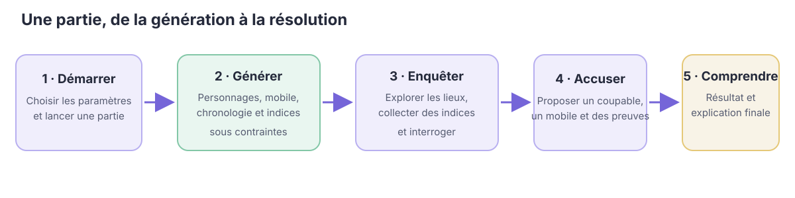
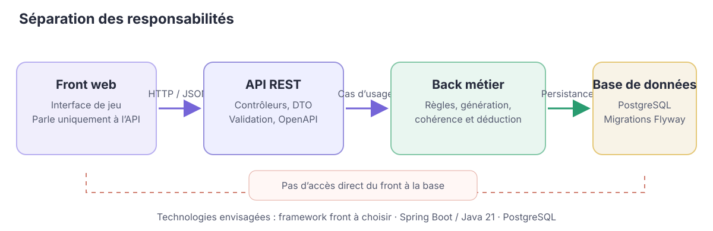
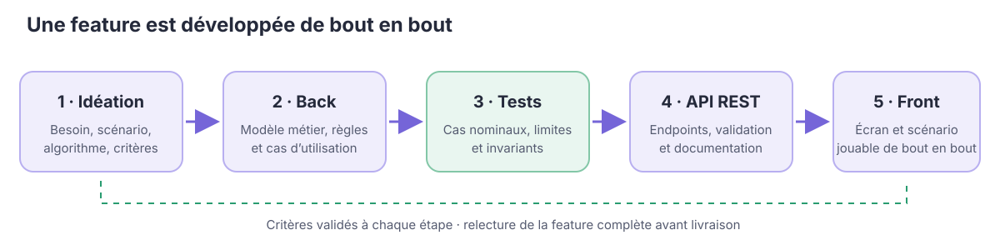
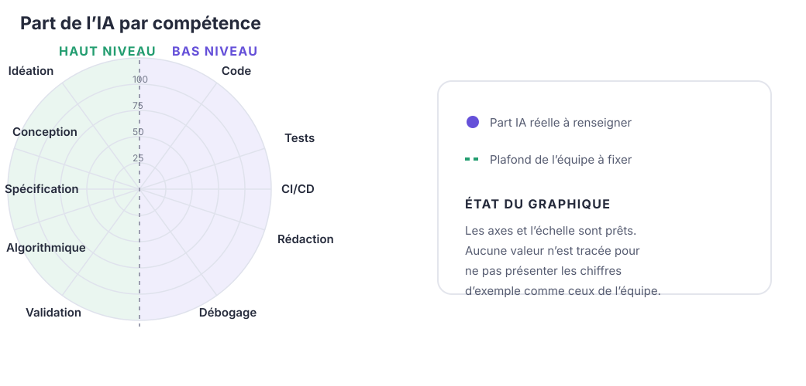

**Formation :** Master 1 MIAGE Apprentissage · année universitaire 2026–2027  
**Version du document :** 1.2 · **État du projet :** lancement  
**Dépôt principal :** <https://github.com/nourane-hammouda/PlotTwist>  
**Page de projet :** à publier ; URL à ajouter dès qu’elle sera disponible.

# Équipe, comptes développeurs et dépôt

PlotTwist est porté par quatre étudiantes de M1 MIAGE. Les quatre membres sont réunies dans la même équipe ; aucun binôme ni étudiant isolé n’est laissé de côté.

| Membre | Compte développeur GitHub | Adresse configurée pour les commits |
|---|---|---|
| Nourane Hammouda | [@nourane-hammouda](https://github.com/nourane-hammouda) | `nouranehamouda09@gmail.com` |
| Chaïma Mabrouki | [@Chaimambk](https://github.com/Chaimambk) | `chaima.mbk21@gmail.com` |
| Ornela Mothu | [@ornelamt](https://github.com/ornelamt) | `ornelamothu4@gmail.com` |
| Zaineb BenMahmoud | [@zainebbmn](https://github.com/zainebbmn) | `zeyneb.b.mah04@gmail.com` |

Chaque membre configure Git avec le nom et l’adresse associés à son compte GitHub. Les commits et les pull requests permettent de suivre les contributions individuelles. Le dépôt principal héberge le back, l’API, le front et ce dossier dans `/doc` ; aucun dépôt front séparé n’est prévu à ce stade.

# Projet et caractère innovant

PlotTwist est une application qui **génère des enquêtes policières interactives**, puis permet au joueur de les résoudre. Le système assemble personnages, relations, lieux, événements, mobiles, témoignages, indices et fausses pistes. Une enquête courte (environ quinze minutes) vise quatre à six suspects, quatre à six lieux et huit à douze indices.

Le projet ne se limite pas à afficher des récits préécrits ni à gérer des données. Son cœur est un moteur qui construit une enquête **cohérente et résoluble** sous contraintes : le coupable doit avoir un mobile et la possibilité d’agir ; les déplacements doivent respecter la chronologie et le graphe des lieux ; les témoignages et les indices ne doivent pas se contredire ; plusieurs pistes doivent rester plausibles avant l’enquête. Les dialogues seront structurés autour d’intentions prédéfinies, et non d’un chatbot libre.

La dimension innovante et algorithmique porte sur la génération sous contraintes, les graphes de relations et de lieux, la cohérence spatio-temporelle, la détection de contradictions et le classement des suspects. Chaque feature majeure devra exposer un algorithme identifiable, testable et accompagné de ses invariants et cas limites.

Le parcours d’une partie articule les actions du joueur et les vérifications réalisées par le moteur :

# Scénarios d’usage

1. **En tant que joueur**, je lance une nouvelle partie paramétrée, afin d’obtenir une enquête policière inédite, cohérente et résoluble générée sous contraintes.
2. **En tant que joueur**, j’explore les lieux et consulte mon carnet d’enquête, afin de collecter des indices et de construire mes premières pistes.
3. **En tant que joueur**, j’interroge un suspect sur son alibi, ses relations ou un indice, afin de confronter son témoignage aux faits déjà établis.
4. **En tant que joueur**, je consulte la chronologie des événements et les trajets, afin de comparer les alibis et d’identifier des incohérences spatio-temporelles.
5. **En tant que joueur**, je formule une accusation (coupable, mobile, preuves) et consulte le bilan, afin de vérifier ma déduction et de comprendre la solution.
6. **En tant qu’enseignant ou démonstrateur**, je démarre une enquête jouable en soutenance, afin de vérifier en direct qu’elle est résoluble sans biais préalable.

Ces six scénarios couvrent la boucle complète de jeu visée. La reprise d’une partie sauvegardée et le réglage fin de difficulté pourront être étudiés ultérieurement, après validation de la boucle initiale.

# Plan des features

À chaque itération, **une feature algorithmique est portée par chaque membre**. Chaque feature est développée de bout en bout et touche la base de données, le back, l’API REST et le front ; elle n’est pas répartie par couche technique. Les axes ci-dessous constituent le découpage fonctionnel proposé. L’attribution nominative des features aux membres reste à valider collectivement avant la v0.1.0.

| Version cible | Génération de l’enquête | Chronologie et déplacements | Indices et déduction | Interactions et résolution |
|---|---|---|---|---|
| **v0.1.0 · 24/11** | Création des personnages et relations — génération de graphe | Chronologie initiale cohérente — contraintes temporelles | Génération et placement d’indices — sélection sous contraintes | Accusation et vérification — comparaison à la solution |
| **v0.2.0 · 08/12** | Choix du coupable et du mobile — filtrage de contraintes | Graphe des lieux et trajets — plus courts chemins | Classement des suspects — score de plausibilité | Interrogatoire structuré — confrontation témoignage/indice |
| **v1.0.0 · 19/01** | Validation globale et régénération — vérification d’invariants | Détection d’incohérences spatio-temporelles — contraintes croisées | Aide adaptative — sélection d’indice selon la progression | Score et bilan explicatif — évaluation de l’accusation |

La v0.1.0 vise une boucle jouable minimale ; la v0.2.0 approfondit les contraintes et prévoit la conteneurisation ; la v1.0.0 vise la résolubilité, l’aide au joueur et la stabilisation. Le périmètre sera ajusté selon les résultats des itérations.

# Architecture et séparation des responsabilités

L’architecture suit le flux imposé **front → API REST → back Java → base de données**. Le front ne communique qu’avec l’API et n’accède jamais directement à la base.

{.architecture-diagram}

::: {.architecture-table}
| Couche / besoin | Choix retenu | Rôle et responsabilités |
|---|---|---|
| Front | Web (HTML/CSS/JS natif ou React/Vue) | Interface de jeu, exploration, carnet d’indices, interrogatoire et accusation |
| API REST | Spring Boot 3, Spring MVC, OpenAPI / Swagger | Endpoints versionnés sous `/api/v1`, validation et erreurs structurées RFC 9457 |
| Back Java | Java 21 (architecture hexagonale) | Règles métier, déductions et génération d’enquêtes sous contraintes hors contrôleurs |
| Graphes | JGraphT | Relations entre personnages, graphe spatial des lieux et calcul de trajets |
| Base de données | PostgreSQL, Spring Data JPA, Flyway | Persistance relationnelle et évolution versionnée du schéma (une migration par feature) |
| Tests et qualité | JUnit 5, Mockito, AssertJ, Testcontainers, JaCoCo | Tests unitaires du domaine sans Spring, tests d’intégration persistance et API |
| Livraison | Docker Compose, GitHub Actions | Environnement reproductible, CI continue et conteneurisation prévue en v0.2.0 |
:::

**Architecture hexagonale et packages.** Le dépôt s'appuie sur un premier squelette sous `src/main/java/fr/miage/plottwist/investigation/`. Le dossier `domain/` isole les modèles, règles et algorithmes sous contraintes en Java pur (sans dépendance Spring) ; `application/` orchestre les cas d'utilisation et ports ; `adapter/` implémente les contrôleurs REST (`adapter/in/web`) et la persistance JPA (`adapter/out/persistence`).

**Modèle commun et entité pivot.** L’entité pivot partagée est la **partie** (`GameSession`), qui relie l’enquête générée, la progression du joueur, les indices collectés et le verdict final. Ce noyau commun garantit la cohérence entre les features développées en parallèle.

**Qualité du code.** Respect des principes SOLID, Clean Code (noms métier explicites, fonctions courtes), conventions REST (codes 201, 400, 404, erreurs RFC 9457), sécurité OWASP (validation `@Valid`, requêtes paramétrées) et *quality gate* continue.

# Démarche de réalisation d’une feature

Les étapes s’enchaînent dans cet ordre : **idéation → back → tests → API REST  → front**. Une étape commence lorsque les critères de fin de la précédente sont satisfaits.

| Étape | Travail attendu | Critère de fin |
|---|---|---|
| Idéation | Besoin, scénario, algorithme et complexité, alternatives, données/API impactées et critères d’acceptation ; issue et fiche dans `doc/features/` | Fiche relue et validée par un autre membre |
| Back | Modèle métier, règles, algorithme, cas d’utilisation et persistance | Code compilé ; règles métier vérifiées |
| Tests | Cas nominaux et limites, invariants, tests d’intégration | Chaque critère d’acceptation est couvert et les tests passent |
| API REST | Endpoints `/api/v1`, DTO validés, erreurs structurées et documentation OpenAPI | API documentée et testée |
| Front | Écrans consommant exclusivement l’API | Scénario jouable de bout en bout et pull request relue |

# Protocole d’usage de l’intelligence artificielle

L’IA est un **outil d’assistance, jamais l’autrice de la décision métier**. Elle peut aider à explorer des options, expliquer une erreur, suggérer des tests, relire ou reformuler la documentation. Elle ne décide pas de l’architecture ni de l’algorithme central de cohérence. Chaque membre doit comprendre, vérifier, adapter et pouvoir expliquer tout élément livré, notamment en soutenance.

| Activité | Assistance possible de l’IA | Responsabilité humaine |
|---|---|---|
| Idéation et conception | Critique et comparaison de pistes | Choix, justification et rédaction de la spécification |
| Algorithmes | Explication et signalement de cas oubliés | Conception, invariants et validation du cœur algorithmique |
| Code et tests | Premier jet technique ou suggestions de cas | Relecture, exécution, adaptation et vérification des tests |
| Documentation et CI | Reformulation ou aide à la configuration | Vérification des faits et compréhension des étapes |

**Interdits.** Commiter du code qu'on ne comprend pas ; confier des secrets ou des données personnelles à l'IA ; commiter sous une autre identité ; présenter comme humain un travail produit par l'IA.

**Traçabilité.** Chaque pull request comporte une section « Usage de l'IA » (outil, objectif, éléments repris, adaptés ou rejetés). La part de l'IA par compétence est déclarée dans le graphe en araignée demandé par le cours (annexe), comparée aux plafonds fixés par l'équipe.

# Annexe — Part de l’IA par compétence {#annexe-part-ia}

Les valeurs ci-dessous ne sont pas encore mesurées ni validées par l’équipe. Elles sont laissées à renseigner plutôt que déclarées à 0 %, puisque ce dossier a bénéficié d’une assistance IA. Les plafonds sont également à fixer collectivement.

| Compétence | Niveau | Part IA (R1) | Plafond fixé par l’équipe |
|---|---|---:|---:|
| Code | Bas | À confirmer | À fixer |
| Tests | Bas | À confirmer | À fixer |
| CI/CD | Bas | À confirmer | À fixer |
| Rédaction | Bas | À confirmer | À fixer |
| Débogage | Bas | À confirmer | À fixer |
| Validation | Haut | À confirmer | À fixer |
| Algorithmique | Haut | À confirmer | À fixer |
| Spécification | Haut | À confirmer | À fixer |
| Conception | Haut | À confirmer | À fixer |
| Idéation | Haut | À confirmer | À fixer |
