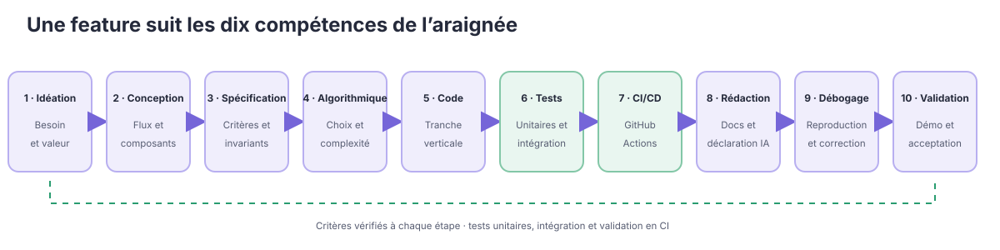
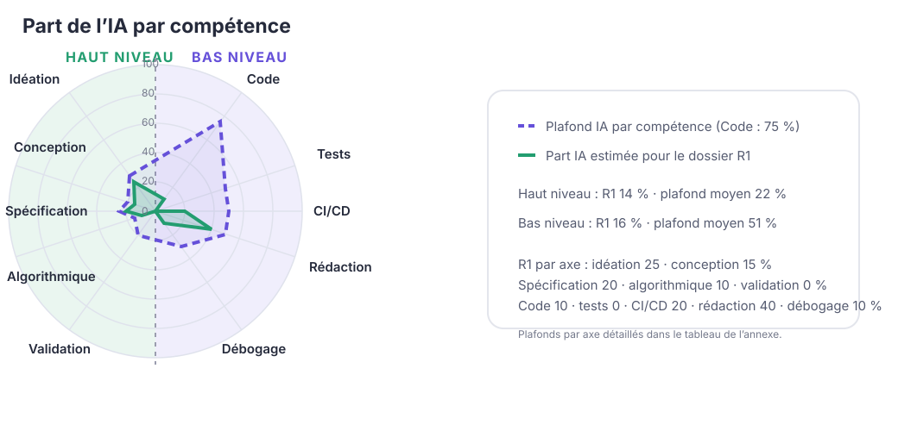

**Formation :** Master 1 MIAGE Apprentissage · année universitaire 2026–2027  
**Version du document :** 1.4 · **État du projet :** lancement  
**Dépôt principal :** <https://github.com/nourane-hammouda/PlotTwist>  
**Page de projet :** à publier ; URL à ajouter dès qu’elle sera disponible.

# Équipe, comptes développeurs et dépôt

PlotTwist est conçu et développé par quatre étudiantes de M1 MIAGE réunies en une équipe unique, sans laisser de binôme ou d’étudiant isolé.

| Membre | Compte développeur GitHub | Adresse configurée pour les commits |
|---|---|---|
| Nourane Hammouda | [@nourane-hammouda](https://github.com/nourane-hammouda) | `nouranehamouda09@gmail.com` |
| Chaïma Mabrouki | [@Chaimambk](https://github.com/Chaimambk) | `chaima.mbk21@gmail.com` |
| Ornela Mothu | [@ornelamt](https://github.com/ornelamt) | `ornelamothu4@gmail.com` |
| Zaineb BenMahmoud | [@zainebbmn](https://github.com/zainebbmn) | `zeyneb.b.mah04@gmail.com` |

Chaque membre a configuré son client Git avec son identifiant et son adresse officielle afin de garantir la traçabilité des commits et des pull requests. Le dépôt unique héberge l'ensemble du projet : back Java, API REST, front web et ce dossier versionné dans `/doc`.

# Projet et caractère innovant

PlotTwist est un **générateur et moteur d’enquêtes policières procédurales en huis clos** (*murder mystery*). Le cœur du jeu repose sur la **construction d’un dossier d’accusation traçable et argumenté** : le joueur doit relier formellement les indices, les mobiles et les fenêtres d'action des suspects pour emporter la conviction du tribunal.

**L'axe de démarcation : une enquête vivante qui avance et se retourne.** Là où Cluedo pose la question *« L’énigme est-elle prouvable ? »* (énigme statique à contraintes) et MindCrime pose *« Qui ment ? »* (duel avec bluff), PlotTwist pose une question inédite : **« Que se passe-t-il quand l’histoire avance pendant que j’enquête ? »**

::: {.comparison-table}
| Dimension | Cluedo | MindCrime | PlotTwist (notre projet) |
|---|---|---|---|
| **Question centrale** | Énigme prouvable sous contraintes | Détection de mensonges & bluff | **Récit dynamique qui évolue et se retourne (*plot twist*)** |
| **Le temps** | Donnée statique à vérifier | Fenêtres horaires à vérifier | **Ressource active qui s’écoule à chaque action du joueur** |
| **Les personnages** | Porteurs passifs d’indices | Adversaires / menteurs | **Agents autonomes (agendas, bouche-à-oreille et réactions)** |
| **Ce qui compte** | Preuve formelle, CSP lourd | Stratégie d’interrogatoire | **Rythme, conséquences des choix et retournement loyal** |
| **Mode de jeu** | Solo académique | 2 modes (enquêteur / criminel) | **Solo narratif centré sur le dossier d'accusation argumenté** |
| **Algorithmes clés** | AC-3, logique épistémique | Expectimax, Dijkstra basique | **VF2 (isomorphisme), simulation à événements discrets, GOAP (A\*), LCS** |
:::

PlotTwist fait vivre un monde réactif : le temps s'écoule à chaque action (simulation à événements discrets), les rumeurs se propagent et se déforment dans le graphe social (BFS), le coupable planifie des sabotages (GOAP / A\*), et le moteur orchestre un **retournement loyal (*twist*)** par recherche de sous-graphe (VF2 dans JGraphT), annoncé par des indices préalables. La graine déterministe (*Seed* `#AF42`) garantit la reproductibilité totale en soutenance.

# Scénarios d’usage

1. **En tant que joueur**, je démarre une enquête sur graine déterministe (`#AF42`) ou aléatoire, afin d’obtenir une intrigue procédurale inédite et certifiée résoluble.
2. **En tant que joueur**, j’explore les lieux pendant que l’horloge tourne et que les suspects suivent leurs agendas, afin de collecter des indices horodatés avec leur source.
3. **En tant que joueur**, j’interroge les témoins pour remonter une rumeur déformée par le bouche-à-oreille jusqu’à son observateur initial dans le graphe social.
4. **En tant que joueur**, je fais face au retournement loyal (*twist*) et aux manœuvres du coupable qui tente de détruire des preuves avant mon arrivée.
5. **En tant que joueur**, je prends des décisions à conséquences (mandats, arrestation) et soumets mon dossier d’accusation argumenté face au procureur.
6. **En tant qu’enseignant**, je charge une graine en soutenance, afin de vérifier en direct le déterminisme de la simulation, la loyauté du twist et les invariants de résolubilité.

# Plan des features

L’équipe s’appuie sur un **socle commun préliminaire (v0.0)** : squelette d'architecture hexagonale, pipeline CI/CD GitHub Actions, conteneurisation PostgreSQL 17 et entité pivot partagée `GameSession`.

Chaque livraison attribue **une feature nominative par membre** (soit 4 membres × 3 livraisons = 12 features au total). Chaque feature traverse l'ensemble des quatre couches (BD, back Java, API REST, front web) et est conçue pour être **utilisable et testable indépendamment**, en ne s'appuyant que sur les briques déjà livrées :

::: {.features-table}
| Version cible | Nourane Hammouda *(Intrigue & Graphe)* | Chaïma Mabrouki *(Espace & Temps)* | Ornela Mothu *(Information & Indices)* | Zaineb BenMahmoud *(Joueur & Verdict)* |
|---|---|---|---|---|
| **v0.1.0 · 24/11** | **F1 · Profils et graphe social** : Multigraphe non orienté sous contraintes d’arité et connexité minimale. *(JGraphT)* | **F2 · Lieux et chronologie initiale** : Graphe connexe des pièces et ordonnancement d'intervalles horaires initiaux. | **F3 · Placement et traçabilité des indices** : Algorithme glouton sous contraintes d’accessibilité, horodatage et source des faits. | **F4 · Accusation et verdict booléen** : Formulaire d'inculpation et comparaison ensembliste avec la vérité terrain. |
| **v0.2.0 · 08/12** | **F5 · Mobiles issus des relations** : Recherche de motifs dans le graphe (triangles de rivalité, dettes par BFS). *[sur F1]* | **F6 · Horloge et agendas des suspects** : Simulation à événements discrets (file de priorité / tas), actions à coût de temps. *[sur F2]* | **F7 · Bouche-à-oreille et rumeurs** : Propagation par niveaux (BFS) dans le graphe social ; déformation selon la distance. *[sur F1, F3]* | **F8 · Décisions à conséquences et mandats** : Moteur de règles en chaînage avant jusqu'au point fixe (mandats, arrestations). *[sur F3, F4]* |
| **v1.0.0 · 19/01** | **F9 · Le Twist loyal** : Catalogue de twists, recherche de sous-graphe isomorphe (VF2) et réécriture sous loyauté ($k$ indices). *[sur F1, F3, F5]* | **F10 · Le coupable brouille les pistes** : Planification d'actions (GOAP) par recherche A\* (destructions traçables, faux alibis). *[sur F3, F6]* | **F11 · Le metteur en scène dramatique** : Régulation de la tension narrative par anticipation sur 2 coups / force brute. *[sur F6, F7]* | **F12 · Fins multiples et flashback** : 4 fins d'enquête, bilan d'accusation motivé et alignement chronologique par LCS. *[sur F4, F6, F8]* |
:::

La v0.1.0 livre la boucle minimale ; la v0.2.0 anime le monde (temps qui s'écoule, rumeurs, conséquences) ; la v1.0.0 apporte le retournement narratif (*twist*), l'IA réactive du coupable et le bilan justifié. La résolubilité n'est pas une feature isolée mais un **invariant de test** vérifié à chaque réécriture et chaque action de sabotage.

# Architecture et séparation des responsabilités

L’architecture respecte rigoureusement le flux unidirectionnel **front → API REST → back Java → base de données**. Le front ne communique qu’avec l’API et n’accède jamais directement à la base.

{.architecture-diagram}

::: {.architecture-table}
| Couche / besoin | Choix retenu | Rôle et responsabilités |
|---|---|---|
| Front | Web modulaire partagé (HTML5 / CSS3 / Vanilla JS) | Interface de jeu unique, composants d'onglets synchronisés, client strict de l'API REST |
| API REST | Spring Boot 3, Spring MVC, OpenAPI / Swagger | Endpoints sous `/api/v1`, DTOs validés (`@Valid`), documentation OpenAPI et RFC 9457 |
| Back Java | Java 21, architecture hexagonale, JGraphT | Domaine métier pur : graphes sous contraintes, simulation à événements discrets, GOAP, LCS |
| Base de données | PostgreSQL 17, Spring Data JPA, Flyway | Persistance relationnelle et schéma versionné (une migration Flyway isolée par feature) |
| Tests & Qualité | JUnit 5, Mockito, AssertJ, Testcontainers, ArchUnit | Tests unitaires (oracles de simulation), tests d’intégration BD/API et respect des frontières |
| Déploiement | Docker Compose, GitHub Actions | Environnement reproductible, intégration continue à chaque push, livraison versionnée |
:::

**Architecture hexagonale et packages.** Le dépôt s’organise sous `src/main/java/fr/miage/plottwist/investigation/`. Le package `domain/` isole les modèles, règles, algorithmes (VF2, A\*, BFS, LCS) et graphes (JGraphT) en Java pur sans framework ; `application/` orchestre les cas d’utilisation et les ports ; `adapter/` regroupe les contrôleurs REST (`adapter/in/web`) et la persistance JPA (`adapter/out/persistence`).

**Socle Frontend commun : « Le Bureau de l’Enquêteur ».** Pour garantir une identité graphique et une ergonomie unifiées sans dispersion, l'équipe partage un socle front unique dans `/front` :
1. *Design System unifié* : feuille de style commune (`style.css`), thème sombre d'ambiance d'enquêteur, typographie et composants atomiques partagés (boutons, modales d'inculpation, badges).
2. *Gestionnaire d'état & Client API centralisé (`api.js`)* : module singleton orchestrant les requêtes HTTP et maintenant l'état de session (`GameSession`, `seed`, progression).
3. *Dashboard modulaire en 4 vues dédiées* : chaque membre implémente son écran métier branché sur le layout commun : *Réseau des suspects* (`suspects-view.js` — Nourane), *Plan & Agendas* (`timeline-view.js` — Chaïma), *Carnet d'indices & Rumeurs* (`clues-view.js` — Ornela), et *Décisions & Accusation* (`verdict-view.js` — Zaineb).

# Organisation de l’équipe et démarche de réalisation

Pour allier rigueur collective et autonomie de développement, l'équipe applique un protocole méthodique en **trois temps** à chaque itération :

1. **Temps 1 — Cadrage collectif amont (Ensemble) :** Avant d’écrire la moindre ligne de code, les quatre membres se réunissent en atelier de co-conception. Elles définissent les scénarios d'interaction, formalisent les contrats d’interface REST (DTOs JSON OpenAPI), verrouillent l’entité pivot partagée `GameSession` et s'accordent sur les oracles de test d'intégration. Chacune sait exactement ce que son module attend et fournit.
2. **Temps 2 — Développement autonome vertical (Individuellement) :** Chaque membre développe sa feature de bout en bout sur sa branche Git dédiée (`feature/<nom>-<fId>`). Elle implémente verticalement les quatre couches : schéma relationnel Flyway, algorithme métier pur dans `domain/`, contrôleur REST Spring sous `/api/v1` et son onglet dédié dans le Dashboard front. Des tests unitaires rigoureux valident les propriétés de son composant en parfaite isolation.
3. **Temps 3 — Intégration collective, revues et recette (Ensemble) :** L'équipe se réunit pour la phase d'alliance. Chaque Pull Request est soumise avec sa traçabilité d'usage de l'IA et relue obligatoirement par un pair. Les branches sont fusionnées sur la branche de release : la suite de tests d'intégration (Testcontainers) s'assure que les modules fonctionnent en synergie, et une recette fonctionnelle complète est jouée à quatre sur le Dashboard unifié avant le tag de livraison.

::: {.steps-table}
| Étape | Responsabilité | Travail attendu | Critère de fin |
|---|---|---|---|
| 1. Cadrage & Spécification | **Collectif (4 membres)** | Scénario, DTOs OpenAPI, oracles et entité pivot `GameSession` | Contrats validés et branche Git créée |
| 2. Back métier & Algorithmes | **Individuel (par membre)** | Modèle métier pur Java, contraintes JGraphT, complexité et invariants | Tests unitaires de domaine au vert |
| 3. Persistance & API REST | **Individuel (par membre)** | Migration Flyway, adaptateurs JPA, endpoints Spring MVC `/api/v1` | ArchUnit et tests MockMvc validés |
| 4. Composant Front Web | **Individuel (par membre)** | Vue dédiée intégrée dans le Dashboard modulaire et branchée sur `api.js` | Scénario de la feature jouable isolément |
| 5. Intégration & Recette | **Collectif (4 membres)** | Revue croisée de PR, tests Testcontainers conjoints et recette globale | Recette validée à 4, merge et release taguée |
:::

# Protocole d’usage de l’intelligence artificielle {#protocole-ia}

L’IA est un **outil d’assistance technique encadré, jamais l’autrice de la conception métier ou de la décision**. L'architecture hexagonale et la cohérence de l'enquête sont conçues exclusivement par les étudiantes, capables d'expliquer chaque ligne en soutenance.

Le flux méthodologique sépare rigoureusement la conception humaine de l'assistance de génération :
$$\text{Humain (spécification \& formalisation des invariants)} \longrightarrow \text{IA (assistance code \& cas de tests)} \longrightarrow \text{Frameworks de tests (oracle) + CI/CD}$$

**Règles et interdits.** Il est formellement interdit de commiter du code non maîtrisé, de transmettre des secrets ou des données personnelles à un outil tiers, de commiter sous une autre identité ou de substituer un LLM au moteur logique du jeu.

**Traçabilité.** Chaque PR contient une section obligatoire « Usage de l’IA » (outils mobilisés, objectifs, suggestions adoptées ou rejetées). La part réelle d'IA par compétence est déclarée et confrontée aux plafonds fixés par l'équipe (annexe).

# Annexe — Part de l’IA par compétence {#annexe-part-ia}

Le tableau ci-dessous formalise l'estimation de l'usage réel de l'IA pour ce dossier de lancement (R1) et fixe les **plafonds maximaux autorisés par l'équipe**. Conformément aux attendus pédagogiques, l'équipe s'impose des plafonds très stricts sur le **Haut niveau** afin de préserver une part humaine prépondérante sur la conception, l'algorithmique et la validation. Les plafonds sont plus souples sur le **Bas niveau**, où l'IA sert d'accélérateur technique encadré.

| Compétence | Niveau | Part IA (R1) | Plafond fixé par l’équipe | Justification et objectifs |
|---|---|---:|---:|---|
| Idéation | Haut | **25 %** | **30 %** | Brainstorming sur les mécaniques d'enquête ; choix et arbitrage 100 % humains. |
| Conception | Haut | **15 %** | **20 %** | Architecture hexagonale et modèle métier entièrement conçus par l'équipe. |
| Spécification | Haut | **20 %** | **25 %** | Formalisation humaine des scénarios ; aide IA pour vérifier l'exhaustivité. |
| Algorithmique | Haut | **10 %** | **15 %** | Cœur algorithmique conçu et calculé par l'humain ; assistance IA sur cas limites. |
| Validation | Haut | **0 %** | **20 %** | Recette, critères d'acceptation et vérification des résultats 100 % humains. |
| Code | Bas | **10 %** | **40 %** | Squelette initial des packages Java ; code métier écrit et relu par l'équipe. |
| Tests | Bas | **0 %** | **50 %** | Pas encore de code de test produit en R1 ; l'IA aidera aux cas de tests en v0.1.0. |
| CI/CD | Bas | **20 %** | **50 %** | Configuration du Makefile et pipeline de build PDF assistés par l'IA. |
| Rédaction | Bas | **40 %** | **50 %** | Relecture, structuration Markdown et mise en forme du dossier avec l'IA. |
| Débogage | Bas | **10 %** | **30 %** | Résolution d'erreurs de rendu et de dépendances Pandoc/WeasyPrint. |
