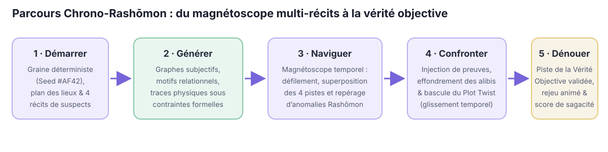

**Formation :** Master 1 MIAGE Apprentissage · année universitaire 2026–2027  
**Version du document :** 1.7 · **État du projet :** v0.1.0 / F1 en cours d’implémentation
**Dépôt principal :** <https://github.com/nourane-hammouda/PlotTwist>  
**Page de projet :** à publier ; URL à ajouter dès qu’elle sera disponible.

# Équipe, comptes développeurs et dépôt

PlotTwist est conçu et développé par quatre étudiantes de M1 MIAGE réunies en une équipe unique, sans laisser de binôme ou d’étudiant isolé.

| Membre | Compte développeur GitHub | Adresse configurée pour les commits |
|---|---|---|
| Nourane Hammouda | [@nourane-hammouda](https://github.com/nourane-hammouda) | `nouranehamouda09@gmail.com` |
| Chaïma Mabrouki | [@Chaimambk](https://github.com/Chaimambk) | `chaima.mbk21@gmail.com` |
| Ornela Mothu | [@ornelamt](https://github.com/ornelamt) | `ornelamothu4@gmail.com` |
| Zaineb BenMahmoud | [@zainebbmn](https://github.com/zainebbmn) | `zeyneb.b.mah04@gmail.com` |

Chaque membre a configuré son client Git avec son identifiant et son adresse officielle afin de garantir la traçabilité des commits et des pull requests. Le dépôt unique héberge l'ensemble du projet : back Java, API REST, front web et ce dossier versionné dans `/doc`.

# Projet et caractère innovant : « Chrono-Rashōmon »

PlotTwist est un **jeu d’enquête policière procédurale à reconstitution temporelle multi-points de vue** (*Chrono-Rashōmon*). L'enquêteur est placé devant un magnétoscope criminel interactif : il doit confronter les versions subjectives et contradictoires de quatre suspects pour reconstituer la **Vérité Objective** et démasquer le coupable.

**Le concept : l'Effet Rashōmon sur timeline interactive.** Chaque suspect présente sa propre piste temporelle de la soirée (sa version des faits, ses trajets et ses alibis). Lorsque le joueur superpose les récits sur la frise temporelle, le moteur surligne automatiquement les **anomalies spatio-temporelles** : deux suspects prétendant être seuls au même endroit, ou des déplacements physiquement impossibles. En récoltant des preuves matérielles (badges d'accès, verres brisés, traces), le joueur « verrouille » des faits physiques irréfutables et fait s'effondrer les faux alibis.

**Le Plot Twist : la bascule temporelle.** Les mensonges des innocents s'expliquent par un délit secondaire (vol, chantage). Mais au moment où l'étau se resserre, une découverte médico-légale révèle un **décalage temporel délibéré** (poison à retardement, corps refroidi) : **toute la frise temporelle glisse de 45 minutes**, anéantissant l'alibi du vrai coupable qui se croyait intouchable !

::: {.comparison-table}
| Dimension | Cluedo | MindCrime | PlotTwist (Chrono-Rashōmon) |
|---|---|---|---|
| **Question centrale** | Énigme statique sous contraintes CSP | Détection de mensonges & duel de bluff | **« Comment réconcilier 4 récits contradictoires jusqu'au twist ? »** |
| **Le temps** | Donnée figée à vérifier | Fenêtres horaires basiques | **Magnétoscope interactif multipiste (récits superposés)** |
| **Les personnages** | Porteurs passifs d'indices | Adversaires / menteurs | **Témoins subjectifs (Effet Rashōmon) aux alibis fragiles** |
| **Ce qui compte** | Preuve formelle, combinaison | Stratégie d’interrogatoire | **Résolution d'interférences temporelles et glissement du twist** |
| **Mode de jeu** | Solo académique | 2 modes (enquêteur / criminel) | **Solo d'analyse temporelle et de reconstitution de la vérité** |
| **Algorithmes clés** | AC-3, logique épistémique | Expectimax, Dijkstra basique | **Algèbre d'intervalles d'Allen, Dijkstra cinématique, sous-graphes, LCS** |
:::

La graine déterministe (*Seed* `#AF42`) assure une reproductibilité totale pour les démonstrations en soutenance.

# Scénarios d’usage

1. **En tant que joueur**, je démarre une enquête sur graine déterministe (`#AF42`) avec le plan des lieux et les récits des 4 suspects.
2. **En tant que joueur**, je navigue sur le magnétoscope temporel, observe les silhouettes sur le plan et repère les incohérences.
3. **En tant que joueur**, j’identifie les anomalies Rashōmon (interférences temporelles où deux versions s'excluent mutuellement).
4. **En tant que joueur**, j’injecte des preuves matérielles horodatées sur la timeline pour briser les faux alibis et révéler les secrets secondaires.
5. **En tant que joueur**, je subis la bascule du Plot Twist (recalibration temporelle) et isole la faille dans l'alibi du vrai coupable.
6. **En tant qu’enseignant**, je lance la reconstitution finale de la Vérité Objective pour vérifier le déterminisme et l'absence de biais.

# Plan des features

L’équipe s’appuie sur un **socle commun préliminaire (v0.0)** : squelette d'architecture hexagonale, pipeline CI/CD GitHub Actions, conteneurisation PostgreSQL 17 et entité pivot partagée `GameSession`.

Chaque livraison attribue **une feature nominative par membre** (soit 4 membres × 3 livraisons = 12 features au total). Chaque feature traverse l'ensemble des quatre couches (BD, back Java, API REST, front web) et est conçue pour être **utilisable et testable indépendamment**, en ne s'appuyant que sur les briques déjà livrées :

::: {.features-table}
| Version cible | Nourane Hammouda *(Récits & Relations)* | Chaïma Mabrouki *(Espace & Cinématique)* | Ornela Mothu *(Preuves & Conflits)* | Zaineb BenMahmoud *(Magnétoscope & Verdict)* |
|---|---|---|---|---|
| **v0.1.0 · 24/11** | **F1 · Profils et récits déclarés** : Multigraphe d'événements subjectifs sous contraintes d’arité. *(JGraphT)* | **F2 · Plan des lieux et topologie** : Graphe connexe des pièces et portes, calcul de distances. | **F3 · Traces matérielles horodatées** : Placement d’indices physiques avec horodatage, source et fait lié. | **F4 · Validation d'incohérence initiale** : Détection d'un conflit évident et comparaison booléenne avec la vérité terrain. |
| **v0.2.0 · 08/12** | **F5 · Motifs de mensonges et secrets** : Génération des complots secondaires (vol, chantage par BFS). *[sur F1]* | **F6 · Trajectoires et cinématique (Dijkstra)** : Plus courts chemins de marche et détection de téléportations impossibles. *[sur F2]* | **F7 · Détecteur d'interférences (Allen)** : Détection automatique des contradictions d'alibis par algèbre d'intervalles. *[sur F1, F3]* | **F8 · Mécanique de confrontation** : Application d’une preuve sur la piste d'un suspect pour forcer l'aveu. *[sur F3, F4]* |
| **v1.0.0 · 19/01** | **F9 · Le Plot Twist narratif** : Catalogue de twists, réécriture sous invariant de résolubilité (alibi masqué). *[sur F1, F3, F5]* | **F10 · Recalibration spatio-temporelle** : Glissement de la frise temporelle et convergence vers le lieu fatal. *[sur F2, F6]* | **F11 · La preuve pivot résolutoire** : Génération (par entropie de Shannon) de l'indice révélant le décalage temporel. *[sur F3, F7]* | **F12 · Reconstitution de la Vérité & Score** : Rejeu fluide animé de la vérité objective, alignement LCS et score. *[sur F4, F6, F8]* |
:::

La v0.1.0 livre la boucle minimale ; la v0.2.0 active le moteur de confrontation (Dijkstra, algèbre d'Allen, aveux) ; la v1.0.0 déploie le retournement temporel (*twist*) et le rejeu animé complet. La résolubilité et le déterminisme sont des **invariants de test stricts** vérifiés automatiquement.

## Avancement F1 — Profils et récits déclarés

La branche `feature/F1-Profils-et-récits-déclarés` met en place un chemin vertical testable indépendamment :

- **Base de données** : migration Flyway isolée `V1__create_f1_profiles_and_subjective_events.sql` avec profils, événements subjectifs et participants ;
- **Back Java** : modèle métier pur, validation d’arité de 1 à 4 participants, multigraphe JGraphT reliant les participants d’un même événement ;
- **API REST** : contrat sous `/api/v1/f1` pour lire/créer les profils, lire/créer les récits et obtenir le résumé du graphe ;
- **Front web** : vue `Pistes des suspects` branchée sur `api.js`, affichant les quatre profils, la frise des déclarations et les compteurs du graphe ;
- **Fixture** : graine déterministe `#AF42` avec quatre suspects et quatre événements indépendants de F2, F3 et F4 ;
- **Validation** : tests unitaires JGraphT et test MockMvc du fixture/contrat API.

Une vérification sur branche a confirmé la compilation Maven complète des 37 sources principales. Le résumé du graphe a été corrigé pour comptabiliser les profils de la graine indépendamment des événements chargés et effectuer une seule lecture des récits. Le build propre et les 3 tests F1 passent.

La configuration Maven Java du workspace est définie dans `.vscode/settings.json` avec synchronisation automatique du classpath afin que les imports Spring et JGraphT soient résolus dans VS Code comme lors du build Maven.

Cette livraison F1 peut être lancée seule avec Maven et H2 pour les démonstrations locales ; PostgreSQL reste l’implémentation cible via la migration Flyway.

# Architecture et séparation des responsabilités

L’architecture respecte rigoureusement le flux unidirectionnel **front → API REST → back Java → base de données**. Le front ne communique qu’avec l’API et n’accède jamais directement à la base.

{.architecture-diagram}

::: {.architecture-table}
| Couche / besoin | Choix retenu | Rôle et responsabilités |
|---|---|---|
| Front | Web modulaire partagé (HTML5 / CSS3 / Vanilla JS) | Interface unique : plan 2D interactif, magnétoscope temporel multi-pistes, client strict de l'API |
| API REST | Spring Boot 3, Spring MVC, OpenAPI / Swagger | Endpoints sous `/api/v1`, DTOs validés (`@Valid`), documentation OpenAPI et RFC 9457 |
| Back Java | Java 21, architecture hexagonale, JGraphT | Domaine métier pur : graphes d'événements, algèbre d'intervalles d'Allen, cinématique, LCS |
| Base de données | PostgreSQL 17, Spring Data JPA, Flyway | Persistance relationnelle et schéma versionné (une migration Flyway isolée par feature) |
| Tests & Qualité | JUnit 5, Mockito, AssertJ, Testcontainers, ArchUnit | Tests unitaires (oracles d'intervalles), tests d’intégration BD/API et respect des frontières |
| Déploiement | Docker Compose, GitHub Actions | Environnement reproductible, intégration continue à chaque push, livraison versionnée |
:::

**Architecture hexagonale et packages.** Le dépôt s’organise sous `src/main/java/fr/miage/plottwist/investigation/`. Le package `domain/` isole les modèles, règles, algorithmes (Allen, Dijkstra, LCS) et graphes (JGraphT) en Java pur ; `application/` orchestre les cas d’utilisation et les ports ; `adapter/` regroupe les contrôleurs REST (`adapter/in/web`) et la persistance JPA (`adapter/out/persistence`).

**Socle Frontend commun : « Le Studio Chrono-Rashōmon ».** Pour garantir une identité graphique et une ergonomie unifiées sans dispersion, l'équipe partage un socle front unique dans `/front` :
1. *Design System unifié* : feuille de style commune (`style.css`), thème sombre polar, typographie et composants atomiques réutilisables (curseur temporel, modales, badges).
2. *Gestionnaire d'état & Client API centralisé (`api.js`)* : module singleton orchestrant les requêtes HTTP et maintenant l'état de session (`GameSession`, `seed`, progression temporelle).
3. *Dashboard modulaire en 4 vues dédiées* : chaque membre implémente son écran métier branché sur le layout commun : *Pistes des suspects* (`suspects-view.js` — Nourane), *Plan des lieux* (`timeline-view.js` — Chaïma), *Inventaire des preuves* (`clues-view.js` — Ornela), et *Table d'accusation & Reconstitution* (`verdict-view.js` — Zaineb).

# Organisation de l’équipe et démarche de réalisation

Pour allier rigueur collective et autonomie de développement, l'équipe applique un protocole méthodique en **trois temps** à chaque itération :

1. **Temps 1 — Cadrage collectif amont (Ensemble) :** Avant d’écrire la moindre ligne de code, les quatre membres se réunissent en atelier de co-conception. Elles définissent les scénarios d'interaction, formalisent les contrats d’interface REST (DTOs JSON OpenAPI), verrouillent l’entité pivot partagée `GameSession` et s'accordent sur les oracles de test d'intégration. Chacune sait exactement ce que son module attend et fournit.
2. **Temps 2 — Développement autonome vertical (Individuellement) :** Chaque membre développe sa feature de bout en bout sur sa branche Git dédiée (`feature/<nom>-<fId>`). Elle implémente verticalement les quatre couches : schéma relationnel Flyway, algorithme métier pur dans `domain/`, contrôleur REST Spring sous `/api/v1` et son composant Front dédié. Des tests unitaires rigoureux valident les propriétés de son composant en parfaite isolation.
3. **Temps 3 — Intégration collective, revues et recette (Ensemble) :** L'équipe se réunit pour la phase d'alliance. Chaque Pull Request est soumise avec sa traçabilité d'usage de l'IA et relue obligatoirement par un pair. Les branches sont fusionnées sur la branche de release : la suite de tests d'intégration (Testcontainers) s'assure que les modules fonctionnent en synergie, et une recette fonctionnelle complète est jouée à quatre sur le Dashboard unifié avant le tag de livraison.

::: {.steps-table}
| Étape | Responsabilité | Travail attendu | Critère de fin |
|---|---|---|---|
| 1. Cadrage & Spécification | **Collectif (4 membres)** | Scénario, DTOs OpenAPI, oracles et entité pivot `GameSession` | Contrats validés et branche Git créée |
| 2. Back métier & Algorithmes | **Individuel (par membre)** | Modèle métier pur Java, contraintes JGraphT, complexité et invariants | Tests unitaires de domaine au vert |
| 3. Persistance & API REST | **Individuel (par membre)** | Migration Flyway, adaptateurs JPA, endpoints Spring MVC `/api/v1` | ArchUnit et tests MockMvc validés |
| 4. Composant Front Web | **Individuel (par membre)** | Vue dédiée intégrée dans le Dashboard modulaire et branchée sur `api.js` | Scénario de la feature jouable isolément |
| 5. Intégration & Recette | **Collectif (4 membres)** | Revue croisée de PR, tests Testcontainers conjoints et recette globale | Recette validée à 4, merge et release taguée |
:::

# Protocole d’usage de l’intelligence artificielle {#protocole-ia}

L’IA est un **outil d’assistance technique encadré, jamais l’autrice de la conception métier ou de la décision**. L'architecture hexagonale et la logique de l'enquête sont conçues exclusivement par les étudiantes, maîtresses de chaque composant en soutenance.

$$\text{Humain (spécification \& invariants)} \longrightarrow \text{IA (assistance code \& tests)} \longrightarrow \text{Oracles de tests + CI/CD}$$

**Règles et traçabilité.** Interdiction formelle de commiter du code non maîtrisé, de transmettre des secrets ou d'intégrer un LLM au moteur logique. Chaque PR consigne obligatoirement l'usage de l'IA (outils, objectifs, propositions retenues ou rejetées) pour contrôler le respect des plafonds d'équipe fixés ci-dessous.

# Annexe — Part de l’IA par compétence {#annexe-part-ia}

::: {.ia-table}
| Compétence | Niveau | Part IA (R1) | Plafond fixé par l’équipe | Justification et objectifs |
|---|---|---:|---:|---|
| Idéation | Haut | **25 %** | **30 %** | Brainstorming sur les mécaniques d'enquête ; choix et arbitrage 100 % humains. |
| Conception | Haut | **15 %** | **20 %** | Architecture hexagonale et modèle métier entièrement conçus par l'équipe. |
| Spécification | Haut | **25 %** | **25 %** | Formalisation humaine des scénarios ; aide IA pour vérifier l'exhaustivité et les contrats F1. |
| Algorithmique | Haut | **10 %** | **15 %** | Cœur algorithmique conçu et calculé par l'humain ; assistance IA sur cas limites. |
| Validation | Haut | **0 %** | **20 %** | Recette, critères d'acceptation et vérification des résultats 100 % humains. |
| Code | Bas | **25 %** | **75 %** | Assistance IA sur le squelette F1, les adaptateurs Spring/JPA et les vues front ; implémentation métier revue et maîtrisée par l'équipe. |
| Tests | Bas | **20 %** | **50 %** | Assistance IA sur les tests JGraphT et MockMvc ; oracles et critères d'acceptation validés par l'équipe. |
| CI/CD | Bas | **20 %** | **50 %** | Configuration du Makefile et pipeline de build PDF assistés par l'IA. |
| Rédaction | Bas | **40 %** | **50 %** | Relecture, structuration Markdown et mise en forme du dossier avec l'IA. |
| Débogage | Bas | **15 %** | **30 %** | Résolution d'erreurs de rendu, de dépendances Pandoc/WeasyPrint et d'intégration F1. |
:::
