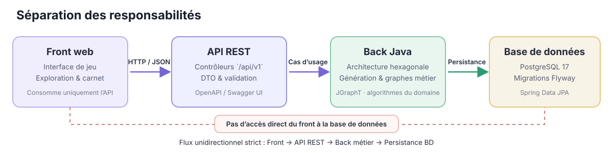

**Formation :** Master 1 MIAGE Apprentissage · année universitaire 2026–2027  
**Version du document :** 1.3 · **État du projet :** lancement 
**Dépôt principal :** <https://github.com/nourane-hammouda/PlotTwist>  
**Page de projet :** à publier ; URL à ajouter dès qu’elle sera disponible.

# Équipe, comptes développeurs et dépôt

PlotTwist est porté par quatre étudiantes de M1 MIAGE. Les quatre membres sont réunies dans la même équipe ; aucun binôme ni étudiant isolé n’est laissé de côté.

| Membre | Compte développeur GitHub | Adresse configurée pour les commits |
|---|---|---|
| Nourane Hammouda | [@nourane-hammouda](https://github.com/nourane-hammouda) | `nouranehamouda09@gmail.com` |
| Chaïma Mabrouki | [@Chaimambk](https://github.com/Chaimambk) | `chaima.mbk21@gmail.com` |
| Ornela Mothu | [@ornelamt](https://github.com/ornelamt) | `ornelamothu4@gmail.com` |
| Zaineb BenMahmoud | [@zainebbmn](https://github.com/zainebbmn) | `zeyneb.b.mah04@gmail.com` |

Chaque membre configure Git avec le nom et l’adresse associés à son compte GitHub. Les commits et les pull requests permettent de suivre les contributions individuelles. Le dépôt principal héberge le back, l’API, le front et ce dossier dans `/doc` ; aucun dépôt front séparé n’est prévu à ce stade.

# Projet et caractère innovant

PlotTwist est une application qui **génère des enquêtes policières interactives**, puis permet au joueur de les résoudre. Le système assemble personnages, relations, lieux, événements, mobiles, témoignages, indices et fausses pistes. Une enquête courte (environ quinze minutes) vise quatre à six suspects, quatre à six lieux et huit à douze indices.

Le projet ne se limite pas à afficher des récits préécrits ni à gérer des données. Son cœur est un moteur qui construit une enquête **cohérente et résoluble** sous contraintes : le coupable doit avoir un mobile et la possibilité d’agir ; les déplacements doivent respecter la chronologie et le graphe des lieux ; les témoignages et les indices ne doivent pas se contredire ; plusieurs pistes doivent rester plausibles avant l’enquête. Les dialogues seront structurés autour d’intentions prédéfinies, et non d’un chatbot libre.

**Différenciation.** PlotTwist se distingue d’un jeu d’enquête fondé sur un scénario entièrement préécrit et d’un générateur de texte libre : le système construit une affaire à partir de données structurées et de contraintes explicites. Le résultat doit pouvoir être vérifié par des règles et des tests, puis expliqué au joueur. La combinaison visée est donc **génération contrôlée + cohérence spatio-temporelle + résolution justifiable**, plutôt que la seule production de dialogues ou d’une histoire. Cette différenciation est un positionnement fonctionnel ; elle ne prétend pas constituer une étude de marché ni une comparaison exhaustive de jeux existants.

La dimension algorithmique porte sur la génération sous contraintes, les graphes de relations et de lieux, la cohérence spatio-temporelle, la détection de contradictions et le classement des suspects. Chaque feature majeure devra exposer un algorithme identifiable, testable et accompagné de ses invariants et cas limites.

Le parcours d’une partie articule les actions du joueur et les vérifications réalisées par le moteur :

# Scénarios d’usage

1. **En tant que joueur**, je lance une nouvelle partie paramétrée, afin d’obtenir une enquête policière inédite, cohérente et résoluble générée sous contraintes.
2. **En tant que joueur**, j’explore les lieux et consulte mon carnet d’enquête, afin de collecter des indices et de construire mes premières pistes.
3. **En tant que joueur**, j’interroge un suspect sur son alibi, ses relations ou un indice, afin de confronter son témoignage aux faits déjà établis.
4. **En tant que joueur**, je consulte la chronologie des événements et les trajets, afin de comparer les alibis et d’identifier des incohérences spatio-temporelles.
5. **En tant que joueur**, je formule une accusation (coupable, mobile, preuves) et consulte le bilan, afin de vérifier ma déduction et de comprendre la solution.
6. **En tant qu’enseignant ou démonstrateur**, je démarre une enquête jouable en soutenance, afin de vérifier en direct qu’elle est résoluble sans biais préalable.

Ces six scénarios couvrent la boucle complète de jeu visée. La reprise d’une partie sauvegardée et le réglage fin de difficulté pourront être étudiés ultérieurement, après validation de la boucle initiale.

# Plan des features et des livraisons

Une feature est un **résultat fonctionnel utilisable et démontrable de bout en bout** : elle possède un scénario utilisateur, une entrée et une sortie identifiables, des critères d’acceptation, et traverse le front, l’API, le back et la persistance concernés. La cible est que les quatre membres livrent chacune une feature à chaque itération : **4 features par version, soit 12 features sur trois versions**. Les noms ci-dessous rendent la responsabilité visible ; chaque feature a une responsable principale, qui la développe, la teste et la présente.

Pour éviter qu’un retard bloque les autres, chaque feature dispose de ses propres données de démonstration (scénario de référence ou fixture) et d’un contrat API convenu avant le développement. Elle peut être testée et montrée sans attendre les autres features de la même version. L’intégration au moteur partagé remplace progressivement les fixtures, sans supprimer la démonstration autonome. Une feature n’est pas une couche technique et ne se découpe pas en quatre lots front/API/back/BD.

**Socle préalable v0.0 (hors quota des 12 features).** Avant v0.1.0, l’équipe met en place le dépôt unique, les conventions de branches et de pull requests, le squelette front/API/back/BD, le modèle pivot `GameSession` et les contrats communs minimaux, ainsi que GitHub Actions pour compiler et exécuter les tests. PostgreSQL est disponible en conteneur pour le développement local ; la conteneurisation de l’application complète est prévue en v0.2.0. Le squelette de packages Java existe déjà ; le socle exécutable et la CI restent à mettre en place. Ce travail prépare les features, mais ne compte pas comme une feature fonctionnelle.

Chaque tableau donne quatre responsables principales, une par membre et par livraison. Toutes les features traversent les quatre couches (front, API REST, back Java, base de données) et ont leur propre fixture, contrat API et critères d’acceptation. La fixture permet de développer, tester et démontrer la feature sans attendre les autres membres ; l’intégration aux données et algorithmes partagés se fait ensuite.

### v0.1.0 · 24/11

| Nourane Hammouda | Chaïma Mabrouki | Ornela Mothu | Zaineb BenMahmoud |
|---|---|---|---|
| **F1 · Suspects et relations.** Générer un graphe de relations aléatoire sous contraintes d’arité. **Acceptation :** le graphe persisté respecte les bornes configurées et s’affiche dans l’enquête de référence. | **F2 · Lieux et chronologie initiale.** Ordonner les événements par tri topologique avec contraintes d’intervalles. **Acceptation :** aucun ordre de précédence ni intervalle temporel de la fixture n’est violé. | **F3 · Placement des indices.** Affecter les indices par algorithme glouton sous contraintes d’accessibilité. **Acceptation :** chaque indice placé est accessible dans la fixture et son emplacement est consultable ; si aucun placement n’est possible, l’échec est expliqué. | **F4 · Accusation et verdict de base.** Comparer les ensembles (coupable, mobile, preuves) et évaluer leur conformité. **Acceptation :** chaque composante correcte ou incorrecte est signalée et le verdict correspond à la solution de la fixture. |

### v0.2.0 · 08/12

| Nourane Hammouda | Chaïma Mabrouki | Ornela Mothu | Zaineb BenMahmoud |
|---|---|---|---|
| **F5 · Choix du coupable et des mobiles.** Filtrer les candidats par contraintes croisées (mobile, relations et possibilité d’agir). **Acceptation :** le résultat ne contient que des couples coupable-mobile valides pour la fixture. | **F6 · Trajets et alibis.** Calculer les plus courts chemins (Dijkstra, durées non négatives) dans le graphe des lieux et confronter durée de trajet et alibi. **Acceptation :** le trajet retourné est de coût minimal ; un trajet impossible ou un alibi temporellement impossible est signalé. | **F7 · Suspects et fausses pistes.** Calculer un score de plausibilité par pondération des indices. **Acceptation :** le classement et les facteurs du score sont affichés, y compris pour un jeu de données avec égalités. | **F8 · Interrogatoire structuré.** Parcourir un arbre de décision et confronter témoignage et indice. **Acceptation :** une question reconnue produit la réponse prévue ; une contradiction est reliée à l’indice concerné. |

### v1.0.0 · 19/01

| Nourane Hammouda | Chaïma Mabrouki | Ornela Mothu | Zaineb BenMahmoud |
|---|---|---|---|
| **F9 · Vérifier la résolubilité.** Vérifier les invariants du graphe et rechercher une solution par backtracking. **Acceptation :** les fixtures résoluble, insoluble et ambiguë sont distinguées, avec la cause expliquée. | **F10 · Détecter les incohérences spatio-temporelles.** Propager des contraintes d’intervalles (algèbre d’Allen) entre événements et déplacements. **Acceptation :** chaque conflit de la fixture est signalé avec les événements concernés, sans faux conflit sur le cas valide. | **F11 · Aide adaptative.** Sélectionner l’indice à révéler selon le gain d’information (entropie). **Acceptation :** l’aide réduit l’ensemble de candidats sans révéler directement la solution et respecte les paliers demandés. | **F12 · Évaluer et expliquer l’accusation.** Construire le graphe explicatif des preuves et calculer un score de conformité. **Acceptation :** le bilan relie chaque élément soumis aux faits et à la solution de la fixture. |

Pour chaque feature, l’issue documente aussi la taille des entrées, la complexité attendue, les cas limites et l’oracle de test. Les tests unitaires couvrent l’algorithme ; les tests d’intégration couvrent API et base de données ; un test de validation rejoue le scénario d’acceptation en bout en bout dans GitHub Actions. Une revue par une autre membre précède la fusion. Cette répartition nominative est le plan de travail de l’équipe ; tout changement est explicité dans l’issue concernée.

# Architecture et séparation des responsabilités

L’architecture suit le flux imposé **front → API REST → back Java → base de données**. Le front ne communique qu’avec l’API et n’accède jamais directement à la base.

{.architecture-diagram}

::: {.architecture-table}
| Couche / besoin | Choix retenu | Rôle et responsabilités |
|---|---|---|
| Front | Web (HTML/CSS/JS natif ou React/Vue) | Interface de jeu, exploration, carnet d’indices, interrogatoire et accusation |
| API REST | Spring Boot 3, Spring MVC, OpenAPI / Swagger | Endpoints versionnés sous `/api/v1`, validation et erreurs structurées RFC 9457 |
| Back Java | Java 21, Spring Boot 3, architecture hexagonale, bibliothèque JGraphT | Règles métier, déductions, génération d’enquêtes sous contraintes, graphes de relations et de lieux et calcul de trajets, hors contrôleurs |
| Base de données | PostgreSQL, Spring Data JPA, Flyway | Persistance relationnelle et évolution versionnée du schéma (une migration par feature) |
| Tests et qualité | JUnit 5, Mockito, AssertJ, ArchUnit, Spring Boot Test, Testcontainers, JaCoCo | Tests unitaires du domaine sans Spring, tests d’architecture hexagonale, tests d’intégration de l’API et de la persistance, tests de validation métier de bout en bout sur les critères d’acceptation |
| Livraison | Docker Compose, GitHub Actions | Environnement reproductible, CI continue et conteneurisation prévue en v0.2.0 |
:::

**Architecture hexagonale et packages.** Le dépôt s'appuie sur un premier squelette sous `src/main/java/fr/miage/plottwist/investigation/`. Le dossier `domain/` isole les modèles, règles et algorithmes sous contraintes en Java pur (sans dépendance Spring) ; `application/` orchestre les cas d'utilisation et ports ; `adapter/` implémente les contrôleurs REST (`adapter/in/web`) et la persistance JPA (`adapter/out/persistence`).

**Modèle commun et entité pivot.** `GameSession` est retenue comme pivot du parcours d’un joueur : elle référence l’enquête jouée et porte l’état de progression, les indices collectés et les accusations. Elle ne doit pas devenir une entité « fourre-tout » : l’enquête (`Investigation`), les événements, les suspects, les indices et les accusations restent des éléments métier distincts, avec leurs propres identifiants et règles. La première feature validera ce découpage ; le modèle pourra être ajusté avant généralisation au moteur.

**Stratégie de tests.** Les tests unitaires couvrent les règles et algorithmes du domaine ; les tests d’intégration vérifient les contrats API et les échanges avec PostgreSQL ; les tests de validation métier rejouent les scénarios d’acceptation de bout en bout. Les trois niveaux sont exécutés et doivent réussir dans GitHub Actions avant fusion.

**Qualité du code.** Respect des principes SOLID, Clean Code (noms métier explicites, fonctions courtes), conventions REST (codes 201, 400, 404, erreurs RFC 9457), sécurité OWASP (validation `@Valid`, requêtes paramétrées) et *quality gate* continue. Des tests d’architecture ArchUnit vérifient que le domaine reste indépendant de Spring et des adaptateurs.

# Démarche de réalisation d’une feature

Une feature suit les **dix compétences de l’araignée**. Les étapes sont séparées pour que les décisions humaines, la production, puis les vérifications soient identifiables. Chaque étape laisse une trace dans l’issue ou la pull request.

| Compétence / étape | Responsabilité humaine et livrable | Critère de fin |
|---|---|---|
| **Idéation** | Décrire le besoin utilisateur, la valeur et les limites de la feature dans l’issue. | L’issue est relue par une autre membre, qui confirme le besoin et la démonstration attendue. |
| **Conception** | Choisir le flux utilisateur, les composants touchés et les contrats entre couches ; justifier les alternatives utiles. | Le schéma ou la description du flux et les décisions sont validés avant implémentation. |
| **Spécification** | Écrire les entrées/sorties, critères d’acceptation, invariants, cas limites et données de référence. | Les critères sont observables et validés par la responsable et une relectrice. |
| **Algorithmique** | Choisir l’algorithme et ses structures de données ; exprimer la complexité en fonction de la taille des entrées (par ex. nombre de sommets/arêtes pour un graphe), puis justifier qu’elle convient aux volumes visés. | L’algorithme, ses invariants et sa complexité sont documentés et illustrés par des cas de test. |
| **Code** | Implémenter la tranche verticale front/API/back/persistance selon le contrat convenu. | La feature compile et le scénario nominal fonctionne avec sa fixture. |
| **Tests** | Définir les tests unitaires et d’intégration, puis les scénarios de validation métier. | Les tests locaux couvrent les cas nominaux et limites ; aucun critère d’acceptation n’est laissé sans vérification. |
| **CI/CD** | Maintenir le workflow GitHub Actions et examiner les résultats, sans contourner les contrôles. | Les tests unitaires, d’intégration et de validation passent dans la CI associée à la pull request. |
| **Rédaction** | Rédiger la documentation utilisateur/technique utile et déclarer l’usage IA dans la pull request. | La documentation correspond au comportement livré et a été relue. |
| **Débogage** | Reproduire les anomalies, isoler leur cause et ajouter un test de non-régression. | Le test reproduisant le défaut échoue avant correction et passe ensuite dans la CI. |
| **Validation** | Exécuter la démonstration complète, comparer les résultats aux critères et accepter ou refuser la livraison. | Une autre membre valide la démonstration et la pull request est approuvée avant fusion. |

# Politique d’usage et d’évaluation de l’intelligence artificielle

L’IA est un **outil d’assistance, jamais l’autrice de la décision métier**. Elle peut aider à explorer des options, expliquer une erreur, proposer un brouillon de code ou de tests, relire ou reformuler la documentation. Elle ne décide pas de l’architecture ni de l’algorithme central de cohérence. Chaque membre doit comprendre, vérifier, adapter et pouvoir expliquer tout élément livré, notamment en soutenance.

Les plafonds ci-dessous sont les **limites d’équipe retenues pour les features à partir de v0.1.0**. Ils s’appliquent séparément à chaque compétence, à la part de contribution IA effectivement conservée. Le plafond de chaque compétence de haut niveau est compris entre 15 % et 30 % ; aucun plafond de compétence de bas niveau ne dépasse 50 %.

| Compétence | Niveau | Responsabilité humaine | Assistance possible de l’IA | Plafond IA |
|---|---|---|---|---:|
| Idéation | Haut | Définir le besoin, les options et le choix final. | Questionner le besoin, proposer des pistes à examiner. | 30 % |
| Conception | Haut | Décider et justifier l’architecture et les interactions. | Comparer des options et signaler des compromis. | 20 % |
| Spécification | Haut | Écrire et valider les règles, critères et invariants. | Proposer une liste de cas ou reformuler un critère pour le rendre testable. | 25 % |
| Algorithmique | Haut | Choisir, justifier et savoir expliquer l’algorithme et sa complexité. | Comparer des approches et suggérer des cas limites, sans décider du choix métier. | 15 % |
| Validation | Haut | Choisir les oracles, interpréter les résultats et accepter la livraison. | Suggérer des scénarios de validation ou aider à lire un résultat. | 20 % |
| Code | Bas | Relire, adapter et comprendre tout code avant intégration. | Générer un brouillon, expliquer une API ou proposer un refactoring. | 40 % |
| Tests | Bas | Définir les cas pertinents et vérifier que les tests détectent les erreurs attendues. | Ébaucher des tests, fixtures et cas limites. | 50 % |
| CI/CD | Bas | Comprendre le workflow, ses permissions et ses résultats. | Ébaucher une configuration ou aider à interpréter un échec. | 50 % |
| Rédaction | Bas | Vérifier les faits, décisions et formulations finales. | Structurer, corriger ou reformuler la documentation. | 50 % |
| Débogage | Bas | Reproduire le problème, établir sa cause et vérifier la correction. | Proposer des hypothèses et aider à analyser les traces. | 30 % |

**Règles.** Pour l’idéation, la conception, la spécification, l’algorithmique et la validation, l’IA peut questionner ou critiquer, mais l’équipe garde la décision, la rédaction finale et la responsabilité. Pour le code, les tests, la CI/CD, la rédaction et le débogage, une proposition générée n’est jamais intégrée sans vérification. Pour un algorithme, la responsable fixe la taille des entrées à traiter, choisit la complexité acceptable et la justifie ; l’IA peut comparer des solutions ou proposer des cas limites, mais ne valide pas le choix métier. Le flux de travail est : **humain (spécification et formalisation des propriétés) → IA (assistance à la génération de code et de tests) → frameworks de test (oracle automatisé) + CI/CD → validation humaine**. Il est interdit de commiter du code qu’on ne comprend pas, de transmettre des secrets ou données personnelles, de commiter sous une autre identité ou de présenter comme entièrement humain un travail produit par l’IA.

**Mesure et preuve.** À chaque pull request de feature, la responsable déclare pour chacune des dix compétences la part estimée de contribution IA effectivement conservée (par pas de 5 %, avec justification), et distingue les éléments repris, adaptés ou rejetés. Une suggestion non utilisée ne compte pas comme contribution. Une relectrice contrôle la déclaration et les plafonds avant fusion. Si une compétence n’a pas été mobilisée, noter 0 % ; si l’information manque, noter **non mesuré (NM)**. La section « Usage de l’IA » de la pull request indique aussi l’outil, l’objectif et les éléments concernés.

**Estimation réelle pour R1.** Les pourcentages ci-dessous sont l’estimation de l’équipe pour la part d’éléments IA conservés dans ce rendu ; ils sont déclaratifs et non une mesure automatique du temps. Les justifications précisent ce qui a été assisté et ce qui est resté humain. Ils décrivent R1, pas l’usage IA des futures features.

# Annexe — Part de l’IA par compétence {#annexe-part-ia}

Le polygone pointillé représente les plafonds d’équipe fixés pour les dix compétences. Le polygone plein représente l’estimation réelle du dossier R1, reportée dans le tableau ; toutes les valeurs R1 restent sous les plafonds. Les moyennes par niveau sont calculées sur les cinq compétences : **haut niveau, IA 14 % / plafond moyen 22 % ; bas niveau, IA 16 % / plafond moyen 44 %**. Pour chaque future feature, les valeurs seront reportées à partir des déclarations et preuves de pull request décrites dans le protocole. Les activités sans mesure sont notées **NM**.

| Compétence | Niveau | Part IA (R1) | Plafond équipe |
|---|---|---:|---:|
| Idéation | Haut | 25 % | 30 % |
| Conception | Haut | 15 % | 20 % |
| Spécification | Haut | 20 % | 25 % |
| Algorithmique | Haut | 10 % | 15 % |
| Validation | Haut | 0 % | 20 % |
| Code | Bas | 10 % | 40 % |
| Tests | Bas | 0 % | 50 % |
| CI/CD | Bas | 20 % | 50 % |
| Rédaction | Bas | 40 % | 50 % |
| Débogage | Bas | 10 % | 30 % |

**Justification des estimations R1.** Idéation (25 %) : pistes de mécaniques proposées par l’IA, arbitrage humain. Conception (15 %) : architecture hexagonale et modèle décidés par l’équipe, avec comparaison d’options assistée. Spécification (20 %) : scénarios formalisés par l’équipe, aide IA à vérifier leur couverture. Algorithmique (10 %) : cœur conçu par l’équipe, aide sur des cas limites. Validation (0 %) : critères, oracles et décision de recette humains. Code (10 %) : aide limitée au squelette initial, code métier écrit et relu par l’équipe. Tests (0 %) : aucun code de test produit pour R1. CI/CD (20 %) : aide à la configuration du Makefile et au processus de génération du PDF. Rédaction (40 %) : aide à la structuration, relecture et mise en forme du dossier. Débogage (10 %) : aide au diagnostic des problèmes de rendu Pandoc/WeasyPrint.
